# IPTV 101

Reproductor de IPTV para Windows, con **interfaces de distintas épocas de Windows** (Windows 95
hasta Windows 10/11) y **sin ninguna lista de canales precargada**: cada persona importa sus
propias listas (`.m3u`/`.m3u8`, locales o por URL).

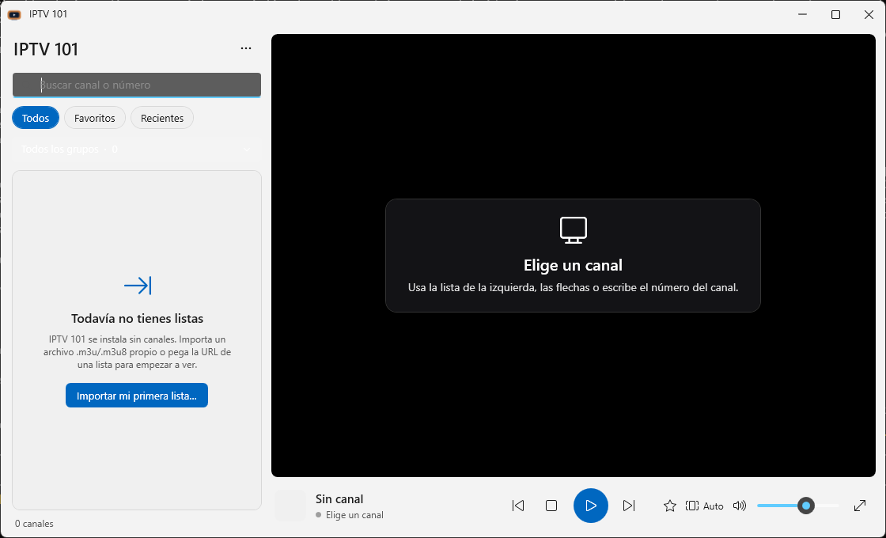

## Características

- **Reproducción real** de IPTV vía [mpv](https://mpv.io/) sobre Direct3D11: HLS, M3U/M3U8 con
  `#EXTINF`, `#EXTVLCOPT` y `#EXTHTTP` (user-agent y referer por canal), pantalla completa,
  recuperación automática ante cortes.
- **Importador de listas** (menú `···` → *Importar o gestionar listas…*):
  - Desde un archivo `.m3u`/`.m3u8` en el disco.
  - Desde una URL remota (`http`/`https`), con manejo de errores claro si falla la descarga.
  - Gestión de varias listas a la vez: ver cuántos canales trae cada una, actualizarla o quitarla.
  - **Sin canales precargados**: recién instalada, IPTV 101 muestra un estado vacío que invita a
    importar la primera lista.
- **Control remoto y teclado**: números para saltar de canal, flechas, RePág/AvPág, favoritos,
  relación de aspecto, silencio, información técnica en pantalla. Ver *Acerca de IPTV 101* dentro
  de la app para el detalle completo de atajos.
- **8 apariencias de época**, cambiables en caliente desde el menú `···` → *Apariencia*, sin
  reiniciar la app: Windows 95, 98, Me, 2000, XP, 7, 8 y 10/11. Cada una rehace colores, bordes,
  botones y la barra de título — no es solo un cambio de color.

## Capturas de las 8 apariencias

| | | |
|---|---|---|
| 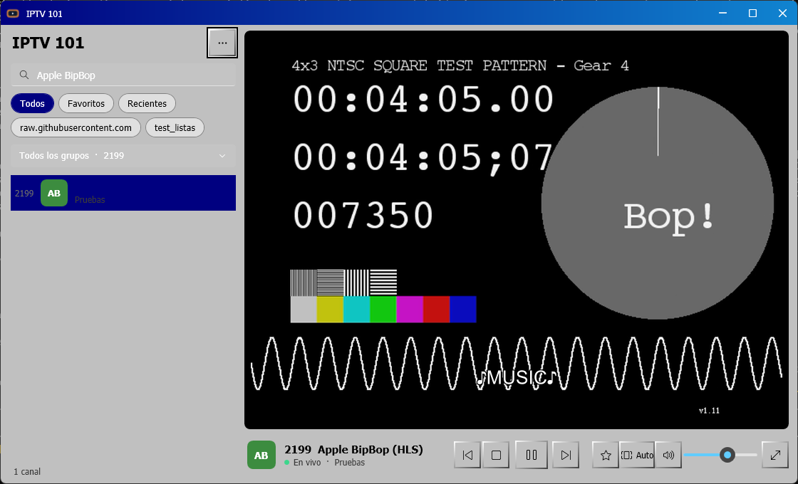 Windows 95 | 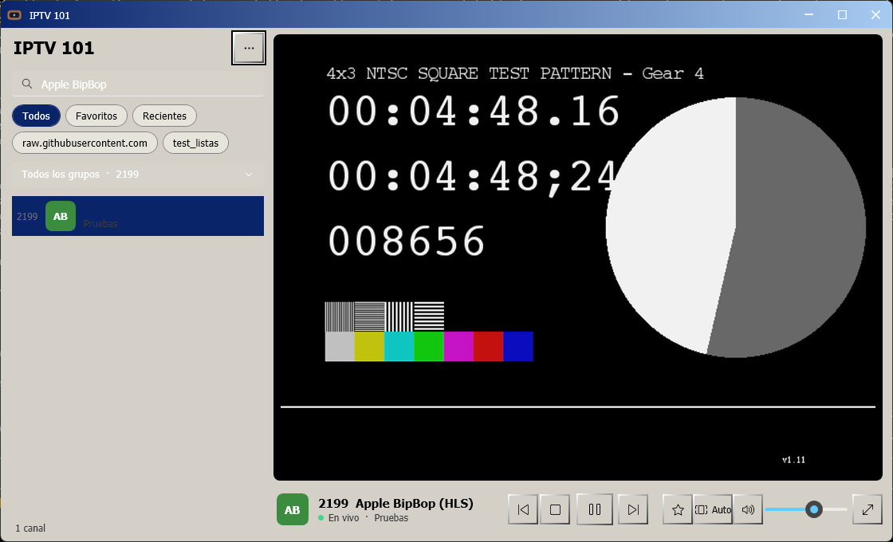 Windows 98 | 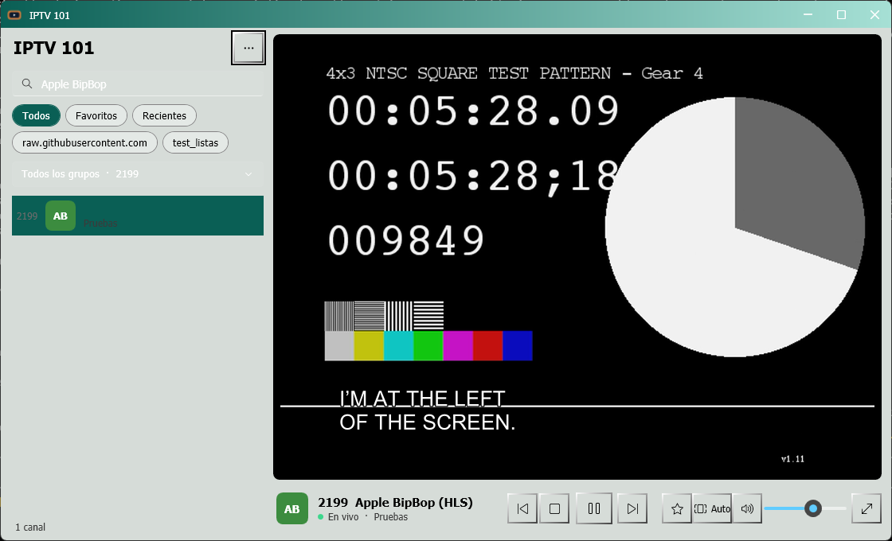 Windows Me |
| 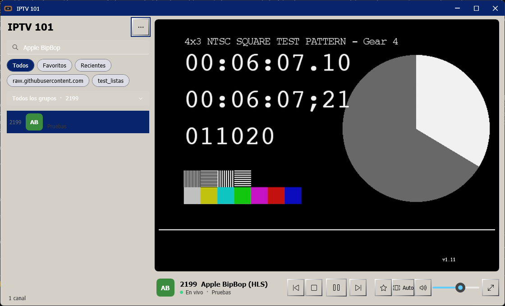 Windows 2000 | 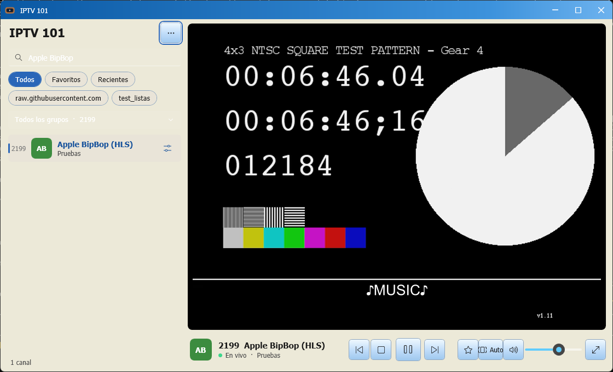 Windows XP | 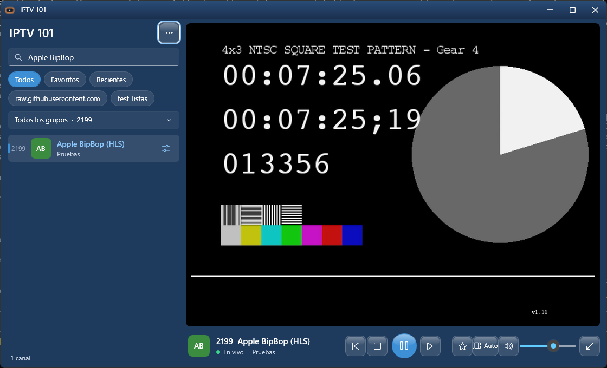 Windows 7 |
| 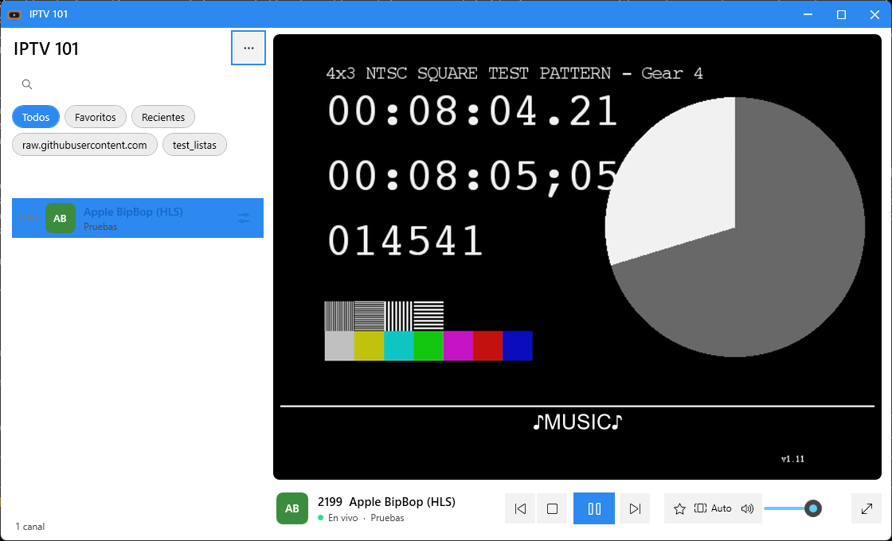 Windows 8 | 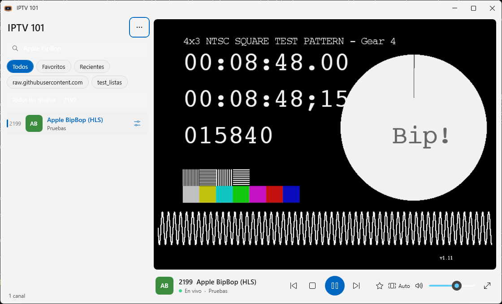 Windows 10/11 | 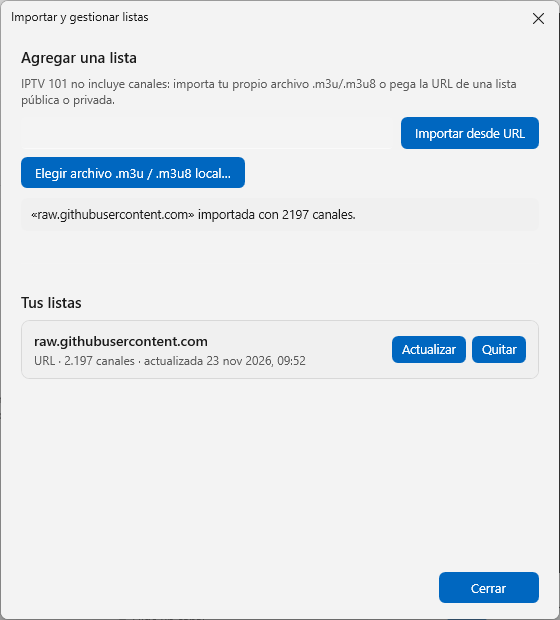 Importador de listas |

Reproducción real en vivo (HLS) sobre la apariencia Windows 95, demostrando que el cambio de
apariencia no interrumpe el video:

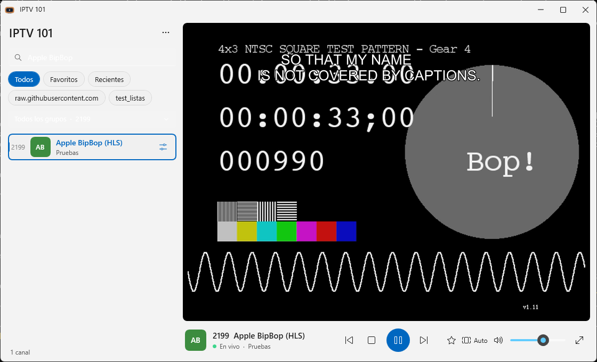

## Instalación

### Desde el instalador / Microsoft Store

(Cuando esté publicada) buscar **IPTV 101** en la Microsoft Store, o descargar el instalador
desde la sección de versiones (*Releases*) del repositorio.

### Compilar desde el código fuente

Requisitos: Windows 10/11 de 64 bits y el [SDK de .NET 10](https://dotnet.microsoft.com/download).

```powershell
git clone https://github.com/navarretenoir/iptv101.git
cd iptv101
# libmpv-2.dll se descarga desde los Releases del repositorio:
# https://github.com/navarretenoir/iptv101/releases
# y se coloca en la carpeta runtime/ (o se pasa con -RutaLibmpv <ruta>)
.\compilar.ps1 -Ejecutar
```

El script deja el ejecutable en `.\publicacion\IPTV101.exe` junto con `libmpv-2.dll`. No requiere
permisos de administrador ni instala nada fuera de su propia carpeta.

> **Motor de video (`libmpv-2.dll`):**
> Pesa ~116 MB y **no se incluye en el historial de git**. Para compilar o ejecutar el proyecto localmente,
> descarga `libmpv-2.dll` desde los [Releases de GitHub](https://github.com/navarretenoir/iptv101/releases)
> y guárdalo en la carpeta `runtime/` (o pásale la ruta a `.\compilar.ps1 -RutaLibmpv <ruta>`).

## Uso: importar tus listas

IPTV 101 **no trae ningún canal**. Al abrirla por primera vez vas a ver una invitación a importar:

1. Abre el menú `···` (arriba a la derecha de la lista de canales) → **Importar o gestionar
   listas…**
2. Para un archivo que ya tienes: **Elegir archivo .m3u / .m3u8 local…**
3. Para una lista publicada en internet: pega la URL en el campo y presiona **Importar desde
   URL**.
4. Repite para tantas listas como quieras. Cada una aparece como una píldora de filtro en la
   barra lateral y se puede actualizar o quitar individualmente desde la misma ventana.

Las listas importadas se guardan en `%LOCALAPPDATA%\IPTV101\listas\`; los ajustes de la app
(volumen, favoritos, recientes, apariencia elegida, tema) en `%LOCALAPPDATA%\IPTV101\ajustes.json`.
Nada de esto se incluye en el instalador ni en este repositorio.

## Hoja de ruta

Esta primera versión pública es **exclusivamente la aplicación de escritorio para Windows**. Las
siguientes plataformas son puertos a una tecnología completamente distinta (no un simple reskin) y
quedan pendientes, sin fecha comprometida todavía:

- [ ] **Android**: app nativa (o empaquetada) para TV boxes y celulares/tablets Android.
- [ ] **Linux**: paquetes para las principales distribuciones (Flatpak como primera opción por
      alcance multi-distro; `.deb`/`.rpm` nativos a evaluar según demanda).

Si quieres ayudar a priorizar o aportar con alguno de estos puertos, abre un *issue* en el
repositorio.

## Licencia

Código propio bajo licencia [MIT](LICENSE). Incluye en tiempo de ejecución `libmpv-2.dll`
(GPLv2+, sin enlazado estático ni modificaciones) — ver [`runtime/PROCEDENCIA.txt`](runtime/PROCEDENCIA.txt)
para su origen y código fuente.

## Autoría

Creado por **Javiera Navarrete**.
